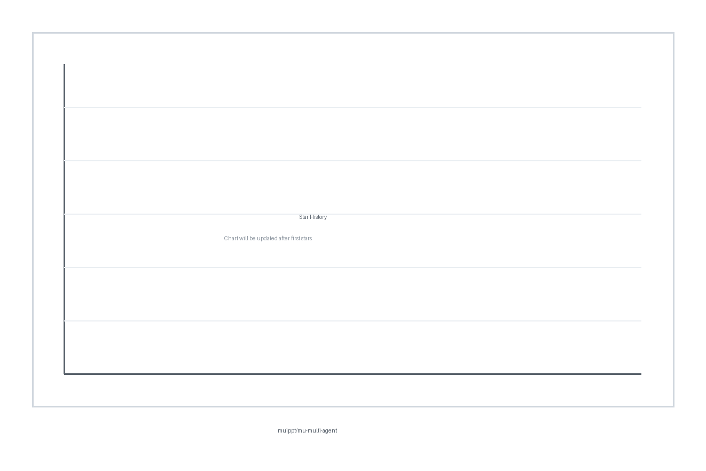

<p align="center">
  
</p>

# 🐝 mu-multi-agent · 多Agent协作指挥官

> Three topics to research, ten resumes to screen, and a report due before you leave? This skill turns one AI agent into a coordinated team — parallel researchers, separate drafters, and an independent reviewer — and its very first move is telling you which tasks don't need a team at all.

**English** | [中文](README_CN.md) | [🌐 Landing Page](https://muippt.github.io/mu-multi-agent/)

[](https://mp.weixin.qq.com/s/YLtXENt_7WzO2DgJCFUtPA)
[](https://xhslink.com/m/ESxtgUNMdl)
[](https://item.m.jd.com/product/14547345.html)
[](https://muippt.github.io/mu-skill-hub/)
[](LICENSE)
[](https://github.com/muippt/mu-multi-agent/releases)
[](https://github.com/muippt/mu-multi-agent/stargazers)

---

### 💡 Usage Examples

- 🔍 **Parallel research, one report** — three investigators head out at the same time and the lead agent merges their findings, so you get one synthesized report instead of three tabs that disagree.
- 🧮 **Batch resume screening** — multiple reviewers screen in parallel; you receive a single comparison table with rankings, not ten separate write-ups.
- 🏁 **Multi-dimension competitor analysis** — pricing, features, and reputation each get a dedicated agent, then one analyst pulls it together.
- ✍️ **Multi-version copywriting** — three drafts in different tones written simultaneously, plus a recommendation of which one to actually use.
- 🌐 **Batch document processing** — a stack of documents translated or summarized in parallel, with the lead agent checking each result as it lands.
- 📝 **High-stakes report pipeline** — research, then a draft, then an independent reviewer scores it before it ever reaches you.
- 🧐 **A second pair of eyes before you hit send** — same AI, fresh context, a five-dimension rubric, and an explicit mandate to find faults, not praise.

---

### ✨ Core Highlights

#### 🚦 It Tells You When NOT to Form a Team

Most multi-agent disasters start with "more agents must be better." Before anything runs, a pre-flight checklist asks whether the task genuinely splits into independent pieces — or whether one agent, or a dedicated single-purpose skill, would do the job better. Simple sequential tasks get politely declined. You save tokens, waiting time, and the special chaos of agents politely quoting each other in circles.

#### 🧭 You Describe the Job, It Picks the Formation

No mode menus, no wiring diagrams. Research-flavored work routes to the commander formation (truly parallel workers with live tools); pure-text tasks like multi-angle analysis or batch translation flow through a fast pipeline; and "do the research first, then give me three versions" automatically becomes a two-phase hybrid. You keep talking about outcomes; the routing takes care of itself.

#### 📜 Three Iron Laws Guard the Spots Where Teams Fall Apart

First, splittability must be judged — a single sequential task never gets force-parallelized. Second, assignments stay minimal: "who + what", nothing bolted on. Third, the lead agent personally synthesizes and verifies the results — raw sub-agent output is never pasted straight through to you. Around these sit a nine-entry pitfall table (silent starts, token blowups, fake-busy agents, spaghetti wiring…) with the wrong way and the right way side by side, plus strict topology rules: linear or fan-out only, and any "just in case" connection gets deleted.

#### 🔎 The Writer Never Grades Their Own Work

An agent that just wrote a report tends to rather like it. This skill separates execution from review: a fresh reviewer agent with its own context scores the output against a five-dimension rubric — facts, structure, logic, evidence, format — and returns either "passed" or a concrete fix list. Same model, noticeably better judgment, because the reviewer wasn't in the room when it was written.

#### 📊 Every Run Ends with a Mission Report

Each run closes with a stats card: which agents ran, in what roles, how long, what status, how much time parallel execution saved versus doing the steps one by one, and how much context was kept out of the main conversation. You can see at a glance whether the team actually paid for itself — and the run isn't declared done until every result is back, merged, and (when a reviewer was used) passed.

#### 🪂 No Sub-Agent Support? It Still Lands on Its Feet

If your agent runtime can't spawn sub-agents at all, the lead agent plays each role in sequence: the pipeline mode stays fully usable, and review separation is preserved by re-reading the work after a gap instead of grading it hot. Slower than true parallel — honestly so — but the discipline survives. No framework to install, no Python, no dependencies; it is a methodology that adapts to the agent you already use.

---

### 📌 Comparison

| Dimension | 🧭 mu-multi-agent | Plain chat prompting | Code-first agent frameworks |
|---|---|---|---|
| Setup | Drop-in skill, zero dependencies | None | Install framework, write orchestration code |
| Decides when multi-agent is warranted | Built-in checklist | You guess every time | You hard-code it |
| Execution vs. review separation | Independent reviewer with 5-dimension rubric | Same context grades itself | Wire it yourself |
| Final synthesis discipline | Lead agent must verify and merge | You copy-paste and reconcile | Wire it yourself |
| Cost visibility | Stats card after every run | None | Framework dashboards |
| Works without writing code | ✅ | ✅ | ❌ |
| Runs where | Any agent supporting the Skill / SKILL.md convention | Any chat window | Python environment |

---

### 🚀 Workflows

| Workflow | When it kicks in | Example trigger |
|---|---|---|
| 🎯 Commander Mode | Multiple directions or sources to research, live tools needed — workers run truly in parallel | "Research these three directions at the same time" |
| 🔄 Pipeline Mode | Pure-text work: multi-angle analysis, multi-style drafts, batch translation | "Analyze this from three different angles" |
| 🔀 Hybrid Mode | Research first, then multiple versions of the output | "Do the research, then give me three draft versions" |

You don't have to say "team up." It wakes up on its own when a task naturally splits into two or more independent subtasks, needs several sources at once, involves a batch of same-type items, or produces a high-stakes output that deserves an independent review. It stays quiet when a single dedicated skill or a simple sequence would do — by design.

**How background reaches the workers**

Sub-agents start with blank slates, so context is injected deliberately — three supported ways:

- **Background injection** (the default): a short "[Background] who needs what, and for whom" line ahead of the task.
- **Prior-results handoff**: for serial steps, the previous agent's findings travel forward as structured notes.
- **File reference**: for heavy background, workers read one context file instead of a wall of text.

**Topology rules — no spaghetti**

Workflows are only allowed to be linear (`A → B → C`) or fan-out (`A → [B, C, D] → E`). Before adding any connection, three questions: does B truly need A's output? Can B work without it? Is this connection "just in case"? If so, delete it.

---

### ⚙️ Technical Specs

| Item | Description |
|---|---|
| Type | Methodology skill (single SKILL.md, prompt-based) |
| Version | 2.2.0 |
| Dependencies | None — no scripts, no packages, no API keys |
| Compatibility | Compatible with Claude Code, Claude Desktop, OpenClaw, and any agent supporting the Skill / SKILL.md convention |
| Capability contracts | 4 abstract contracts: `spawn` · `monitor` · `history` · `notify` (mapped by capability signature, not by tool name) |
| Fallback path | Runtime without sub-agent capability: lead agent serially plays each role; pipeline mode and review separation preserved |
| Skill language | Chinese (usable with prompts in your own language) |
| Files | `SKILL.md` + `assets/` |
| Telemetry | None |
| License | MIT |

---

### 🛠️ Quick Start

**1. Install**

```bash
git clone https://github.com/muippt/mu-multi-agent.git ~/.claude/skills/mu-multi-agent
```

> Other agents may use their own skill directory, or a project-level `.claude/skills/mu-multi-agent`.

**2. Verify**

Restart or reload your agent, then ask:

```text
List my available skills
```

**3. Run**

```text
Screen these 10 resumes for the senior designer role in parallel, and give me one comparison table at the end.
```

Or invoke a specific workflow:

```text
Research competitor pricing, feature gaps, and user reviews at the same time, then synthesize one report.
```

```text
Do the industry background research first, then give me three draft versions of the announcement in different tones.
```

```text
Run this external report through an independent review — score it on the five-dimension rubric before I send it.
```

---

### 🔒 Security & Privacy

- Runs entirely inside your local agent — no servers, no accounts, no sign-ups.
- Zero dependencies, zero scripts, zero telemetry, zero data collection.
- Your files and prompts stay with the agent you already trust; nothing is uploaded anywhere.
- It is a methodology document, not a service — nothing phones home, because there is nothing to phone home with.

---

### ⭐ Star History

If it has saved you an evening of tab-switching and copy-paste reconciliation, a star helps the next person find it.

[](https://www.star-history.com/?repos=muippt%2Fmu-multi-agent&type=date)

> One agent is a pair of hands; a well-briefed team — with the judgment to know when not to field one — is a department.

---

### 👤 About the Author

🎓 Signatory Author of Tsinghua University Press / 2026 Dangdang Influential Author / AI & Large Model Business HR Specialist at a Leading Tech Company / National Level-1 HR Manager / Level-2 Psychological Counselor / Self-taught Designer

📚 Author of [*Visual Team Management*](https://item.m.jd.com/product/14547345.html). Clients include ByteDance, Tencent, Baidu, China Mobile, SMG, BOE…

💡 WeChat Official Account [木先生iPPT](https://mp.weixin.qq.com/s/YLtXENt_7WzO2DgJCFUtPA) / [Xiaohongshu](https://xhslink.com/m/ESxtgUNMdl): muippt

---

### 📄 License & Acknowledgments

[MIT](LICENSE) © 2026 木先生iPPT

Thanks to the open agent community behind the Skill / SKILL.md convention, and to everyone who has shared multi-agent orchestration lessons in the open — the iron laws here are distilled from a healthy number of publicly relatable failures.

> Note: Much of this project was co-created with AI assistance. If you believe your work has been used without proper attribution, please open an issue.
